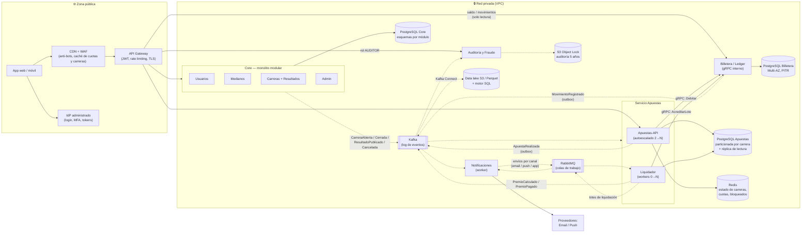

# 4. Diagrama general de arquitectura

**Convenciones:** las flechas **sólidas** (`──▶`) son comunicación **síncrona** (HTTPS/REST o gRPC). Las flechas **punteadas** (`┄┄▶`) son comunicación **asíncrona** (eventos en Kafka o tareas en RabbitMQ).

## Lectura del diagrama en 5 pasos

1. **Entrada única.** Todo el tráfico de usuarios pasa por CDN + WAF → API Gateway. El Gateway valida el JWT emitido por el IdP y aplica *rate limiting*. Nada de la VPC es accesible directamente desde Internet.
2. **Camino caliente (apostar).** Gateway → Apuestas‑API. La API lee de Redis el estado de la carrera y los participantes, debita en la Billetera por gRPC y guarda la apuesta junto con su evento en la *outbox* en una sola transacción. Responde en menos de 1 s.
3. **Difusión de hechos.** Cada servicio publica sus eventos en **Kafka**. Notificaciones, Auditoría/Fraude, el data lake y la proyección de cuotas los consumen de forma independiente y a su propio ritmo.
4. **Trabajo pesado.** Al publicarse un resultado, el Liquidador divide la carrera en lotes y los reparte por **RabbitMQ** entre N *workers*, que acreditan premios en la Billetera.
5. **Datos.** Cada servicio es dueño de su base de datos. El histórico de eventos queda en el data lake (analítica) y en almacenamiento inalterable (auditoría).

## Zonas de red (resumen; el detalle va en la Fase 4)

| Pública | Privada |
|---|---|
| CDN, WAF, API Gateway, IdP | Core, Apuestas, Billetera, Notificaciones, Auditoría y Fraude, Kafka, RabbitMQ, PostgreSQL, Redis, data lake |
