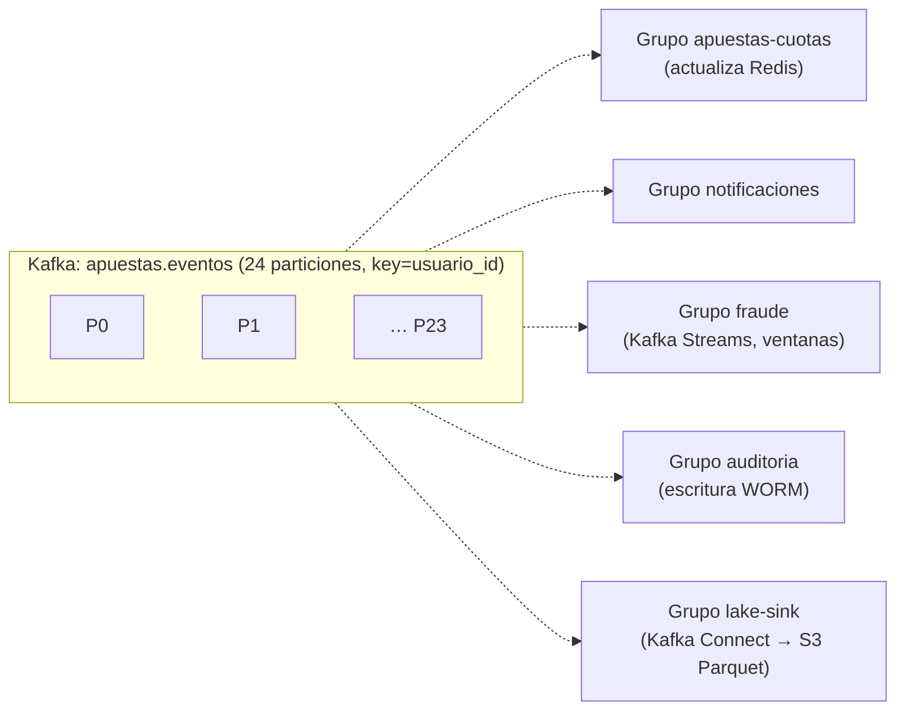
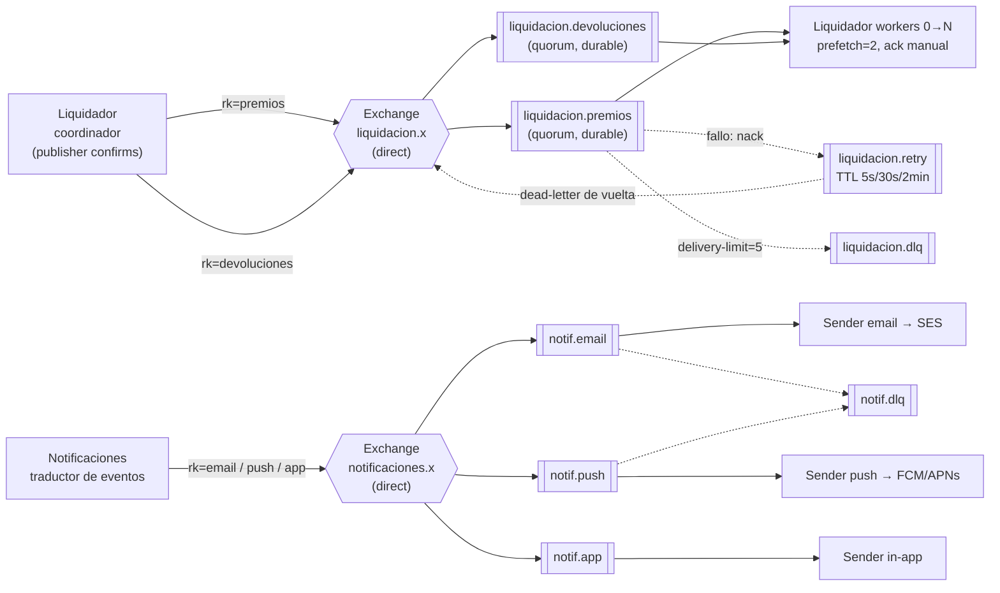

# 7. Decisión 5 — RabbitMQ vs. Kafka y diseño de la mensajería

## 7.1 Decisión

**Usamos ambos, cada uno para un problema distinto y en modo administrado:**

| | **Kafka** — "lo que pasó" | **RabbitMQ** — "lo que hay que hacer" |
|---|---|---|
| **Dónde** | Columna vertebral de **eventos de negocio** (sección 6.3). | **Colas de trabajo**: lotes de liquidación y devoluciones, y envíos de notificaciones por canal. |
| **Por qué** | Un mismo evento lo leen **5 o más consumidores independientes**. Hace falta **historial reproducible** (auditoría, reconstrucción de premios, recalcular analítica). Volumen alto (~10 MB/s en el pico). | Hace falta **repartir tareas** entre *workers* que compiten, con *ack* por mensaje, **reintentos con *backoff***, **DLQ** y *prefetch*. |
| **Qué problema resuelve** | Desacopla productores de consumidores: Apuestas no sabe ni le importa quién escucha. Un consumidor caído se pone al día leyendo desde su *offset*. | Liquidar 1 M de apuestas en < 15 min con N *workers*. Si un lote falla, solo se reintenta **ese** lote. Un proveedor de correo caído no bloquea los *push*. |
| **Servicio administrado** | Amazon MSK (Serverless o provisionado pequeño) / Confluent Cloud | Amazon MQ for RabbitMQ (clúster de 3 nodos) / CloudAMQP |

## 7.2 ¿Por qué no uno solo? (justificación de la complejidad adicional)

| Alternativa | Por qué se descartó |
|---|---|
| **Solo RabbitMQ** | Los mensajes se borran tras el *ack*: **no hay historial reproducible**, que es justo lo que piden la auditoría ("reconstruir cómo se calcularon los premios") y la analítica. Además, para *fan-out* a 5 consumidores habría que duplicar cada mensaje en 5 colas. |
| **Solo Kafka** | Repartir lotes funciona, pero el paralelismo queda **atado al número de particiones**. No hay *ack* ni reintento **por mensaje**: un lote fallido bloquea la partición, salvo que se construyan *topics* de reintento y DLQ a mano. Tampoco hay colas con TTL ni retraso. Se puede hacer, pero es más código propio, más difícil de operar y de explicar. |
| **Ninguno (solo HTTP)** | Acoplamiento temporal: si Notificaciones se cae, fallan las apuestas. Liquidar 1 M de apuestas en una sola petición es inviable (lo dice el enunciado). |

**¿Compensa mantener dos tecnologías?** Sí, por tres razones:
1. **Cada una se usa solo en su punto fuerte**, sin solaparse: Kafka nunca reparte tareas y RabbitMQ nunca guarda historia.
2. **Ambas son administradas**: el proveedor gestiona parches, réplicas y discos. La complejidad operativa que nos queda es configuración, no infraestructura.
3. **El uso de RabbitMQ es acotado**: 5 colas y 2 *exchanges*. Si mañana se quisiera simplificar, la liquidación podría migrarse a Kafka sin tocar el resto (ver la pregunta final).

## 7.3 Diseño de Kafka

### Topics

| Topic | Particiones | Clave | Retención | Productores | Grupos de consumidores |
|---|---|---|---|---|---|
| `usuarios.eventos` | 6 | `usuario_id` | 30 días | Core | `billetera-cuentas`, `apuestas-bloqueados`, `notificaciones`, `auditoria`, `lake-sink` |
| `carreras.eventos` | 6 | `carrera_id` | 30 días | Core | `apuestas-cache`, `liquidador-trigger`, `core-medianos-stats`, `notificaciones`, `fraude`, `auditoria`, `lake-sink` |
| `apuestas.eventos` | **24** | `usuario_id` | 30 días | Apuestas‑API (Debezium outbox) | `apuestas-cuotas`, `notificaciones`, `fraude`, `auditoria`, `lake-sink` |
| `billetera.movimientos` | 12 | `usuario_id` | 30 días | Billetera (Debezium outbox) | `notificaciones`, `fraude`, `auditoria`, `lake-sink` |
| `liquidaciones.eventos` | 3 | `carrera_id` | 30 días | Liquidador | `core-carreras`, `auditoria`, `lake-sink` |
| `premios.eventos` | 12 | `usuario_id` | 30 días | Liquidador (outbox) | `notificaciones`, `auditoria`, `lake-sink` |
| `fraude.alertas` | 3 | `usuario_id` | 30 días | Auditoría y Fraude | `core-admin`, `lake-sink` |
| `admin.acciones` | 3 | `actor_id` | 30 días | Core – Admin | `auditoria`, `lake-sink` |
| `<topic>.<grupo>.dlt` | 1–3 | igual | 30 días | Consumidores ante error | Revisión manual / reproceso |

### Criterios de diseño
- **Clave `carrera_id` en `carreras.eventos`**: garantiza el **orden** de la máquina de estados de una carrera (`Abierta` → `Cerrada` → `ResultadoPublicado`). Un consumidor nunca ve el resultado antes de la apertura.
- **Clave `usuario_id` en `apuestas.eventos`**: reparte el pico de 10.000/s entre 24 particiones (en lugar de concentrarlo en una sola partición caliente, como pasaría con `carrera_id` en la final de la Copa) y conserva el orden por usuario, que es lo que necesita Fraude.
- **24 particiones** = paralelismo máximo de cada grupo consumidor. Una partición moderna aguanta varios MB/s; con 24 hay margen de 10× sobre el pico (~10 MB/s).
- **Durabilidad**: `replication.factor=3`, `min.insync.replicas=2`, productores con `acks=all` y `enable.idempotence=true`. Un *broker* caído no pierde eventos.
- **Retención de 30 días** = ventana para reproducir eventos. La **historia larga** (5 años) se guarda en S3 mediante el *sink* (data lake en Parquet y WORM de auditoría).
- **Publicación con outbox + Debezium (CDC)**: los servicios **no** publican directamente en Kafka dentro de la petición. Escriben el evento en una tabla `outbox` en la **misma transacción** que el cambio de negocio, y Debezium lee el WAL de PostgreSQL y lo publica. Si Kafka está caído, la apuesta igual se guarda y el evento sale después.
- **Consumidores**: confirman (*commit*) el *offset* **después** de aplicar el efecto. Deduplican por `event_id` (ver Decisión 6). Si un mensaje falla 3 veces, va al DLT del grupo.

### Grupos de consumidores (quién lee qué)

Cada grupo lleva **su propio offset**: si el grupo `auditoria` va retrasado 10 minutos, no afecta a `apuestas-cuotas`.

## 7.4 Diseño de RabbitMQ

| Elemento | Configuración | Por qué |
|---|---|---|
| **Producer** | Coordinador del Liquidador y traductor de Notificaciones, con **publisher confirms** y mensajes `persistent`. | El productor sabe que el mensaje quedó durable antes de marcar el lote como "publicado" en su BD. |
| **Exchange** | `liquidacion.x` y `notificaciones.x`, tipo **direct**. | El enrutamiento es simple y exacto por *routing key*. No se necesita *topic* ni *fanout* (el *fanout* ya lo hace Kafka). |
| **Queues** | **Quorum queues** (replicadas en 3 nodos), durables. Una cola por tipo de trabajo y por canal. | No se pierden con la caída de un nodo. Cada canal aísla sus fallos: si SES falla, `notif.push` sigue fluyendo. |
| **Routing** | `premios`, `devoluciones`, `email`, `push`, `app`. | Permite escalar los *workers* por tipo de trabajo. |
| **Consumer** | *Ack* **manual** después de confirmar el efecto en BD/Billetera. `prefetch=2` para repartir de forma equitativa. Escalan con **KEDA** según la longitud de la cola (0 cuando está vacía). | *At-least-once* + efectos idempotentes = **efectivamente una vez**. |
| **Reintentos** | Cola de reintento con TTL escalonado (5 s, 30 s, 2 min), que devuelve el mensaje por *dead-letter* al exchange principal. `delivery-limit=5` en la quorum queue. | *Backoff* sin bloquear la cola principal. |
| **DLQ** | `liquidacion.dlq` y `notif.dlq`, con alerta al operador. Para las notificaciones, se descartan las expiradas (`expira_at`). | Ningún mensaje se pierde en silencio. Se pueden reinyectar tras corregir la causa. |

## 7.5 Garantías de entrega en resumen

| Tramo | Garantía | Mecanismo |
|---|---|---|
| Servicio → Kafka | Al menos una vez, sin pérdida | Outbox transaccional + Debezium + `acks=all` |
| Kafka → consumidor | Al menos una vez | *Commit* del *offset* tras el efecto |
| Coordinador → RabbitMQ | Al menos una vez | Tabla `lotes` en BD + *publisher confirms* + republicación de lotes no confirmados |
| RabbitMQ → *worker* | Al menos una vez | *Ack* manual tras el efecto |
| **Efecto de negocio** | **Exactamente una vez (efectivo)** | **Idempotencia** en consumidores y en la Billetera (Decisión 6) |

> Ningún broker da "exactamente una vez" sobre una base de datos externa. Lo conseguimos combinando entrega *al menos una vez* con **efectos idempotentes**.
