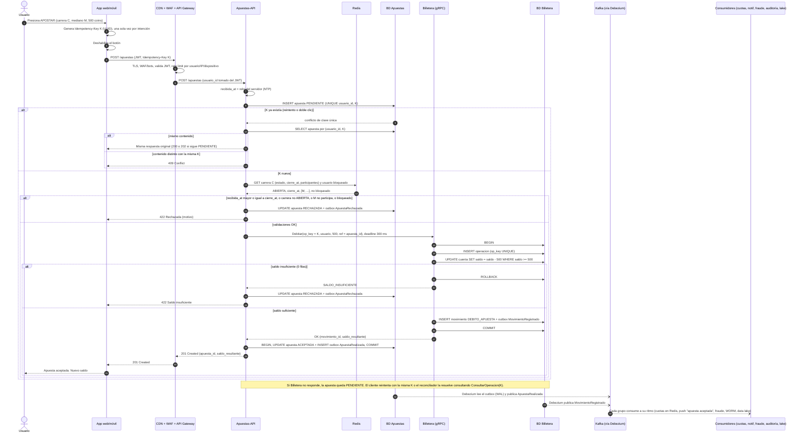

# 8. Diagrama de secuencia — flujo completo de una apuesta

Desde que el usuario presiona **APOSTAR** hasta la confirmación y el descuento en la billetera, incluyendo los caminos de duplicado, cierre y saldo insuficiente.

## Presupuesto de latencia (objetivo: p99 < 1 s)

| Paso | Latencia típica |
|---|---|
| CDN/WAF + Gateway (TLS, JWT, *rate limit*) | 20–40 ms |
| INSERT `PENDIENTE` en BD Apuestas | 2–5 ms |
| Lecturas en Redis | < 1 ms |
| gRPC a Billetera + transacción de débito | 5–20 ms |
| UPDATE `ACEPTADA` + outbox | 2–5 ms |
| Red cliente ↔ nube | 50–150 ms |
| **Total** | **~100–250 ms** (holgura de 4× frente al objetivo de 1 s, para absorber el pico) |

## Por qué este orden de pasos

1. **Primero se inserta `PENDIENTE`** con clave única `(usuario_id, idempotency_key)`. Esa fila es la **deduplicación durable**: aunque lleguen 4 clics en paralelo, solo uno gana el INSERT y los demás reciben la respuesta original.
2. **Después se valida y se debita.** El débito usa la misma clave, así que reintentarlo es seguro.
3. **Por último se confirma `ACEPTADA` + outbox** en una sola transacción local: o quedan ambos o ninguno.
4. Si algo falla entre el paso 2 y el 3, la apuesta queda `PENDIENTE` y se resuelve sola (detalle en [10-datos-y-consistencia.md](10-datos-y-consistencia.md)).
