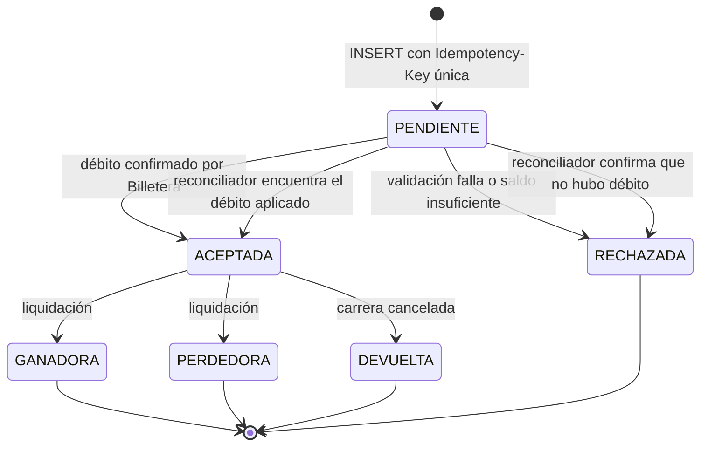
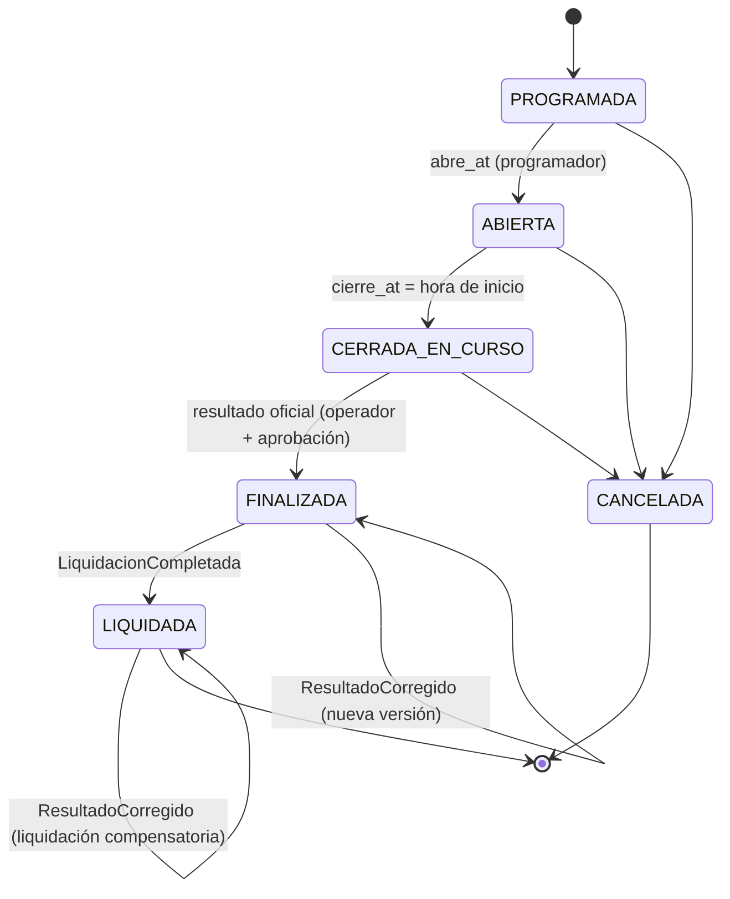

# 10. Decisión 9 — Datos y consistencia

## 10.1 Base de datos por servicio o módulo

| Servicio / módulo | Tipo de almacenamiento | ¿Compartida? | Justificación |
|---|---|---|---|
| **Core** (Usuarios, Medianos, Carreras, Admin) | **PostgreSQL**, una instancia con **un esquema por módulo** y credenciales por módulo | Instancia compartida **entre módulos del Core** y con el esquema de preferencias de Notificaciones (ahorro de costo). **Nadie lee tablas de otro esquema.** | Datos relacionales con poco volumen y necesidad de transacciones (máquina de estados de carreras). |
| **Apuestas** (API + Liquidador) | **PostgreSQL** dedicado. Tabla `apuestas` **particionada por mes** (`recibida_at`), índice `(carrera_id, mediano_id, estado)` y **réplica de lectura** | No | Pico de ~20.000 escrituras/s. Las particiones mantienen índices pequeños y facilitan archivar. La réplica absorbe las lecturas de la liquidación y de "mis apuestas". |
| **Billetera** | **PostgreSQL** dedicado, **Multi‑AZ con replicación síncrona** (RPO = 0), PITR | No | Datos financieros: ACID, consistencia fuerte, cero pérdida. |
| **Notificaciones** | Esquema en la instancia del Core (preferencias, `notificaciones_enviadas`) | Instancia sí, esquema no | Volumen bajo. No justifica una BD propia. |
| **Auditoría y Fraude** | **S3 con Object Lock** (WORM, modo *compliance*, 5 años) + estado de ventanas de fraude en **Kafka Streams (RocksDB)** | No | Inalterabilidad garantizada por el almacenamiento: ni siquiera un administrador puede borrar. |
| **Cachés** (estado de carreras, participantes, cuotas, usuarios bloqueados) | **Redis** administrado (un clúster, prefijos por servicio) | Clúster compartido, claves separadas | **No es fuente de verdad.** Todo es reconstruible desde PostgreSQL o Kafka. |
| **Analítica** | **Data lake en S3 (Parquet)**, particionado por `fecha/tipo_evento`, consultado con **Athena** (o Redshift Serverless para reportes premium) | — | Millones de registros/día a un costo muy bajo. Tolera minutos de retraso. |
| **Histórico de eventos** | Kafka (30 días, para reproducir) → S3 (5 años o más) | — | Kafka para la ventana caliente; S3 para la historia larga y barata. |

## 10.2 Consistencia fuerte vs. eventual

| Dato | Consistencia | Por qué |
|---|---|---|
| Saldo y movimientos de la billetera | **Fuerte** (ACID, una sola BD, fila bloqueada por usuario) | Nunca gastar dos veces. |
| Estado de una apuesta (aceptada o rechazada) | **Fuerte** dentro de Apuestas | El usuario recibe una respuesta definitiva. |
| Apuesta ↔ débito en la billetera | **Fuerte en el resultado visible** (la apuesta solo es `ACEPTADA` si el débito se confirmó). Internamente es una mini‑saga con estado `PENDIENTE` | Ver 10.3. |
| Estado de la carrera y cierre | **Fuerte** en Core. En la caché de Apuestas es **eventual (ms)**, pero el cierre se valida con `cierre_at` (inmutable una vez abierta), no con el estado en caché | El cierre nunca depende de que llegue un evento a tiempo. |
| Resultado oficial y versión | **Fuerte** (Core, versionado, nunca se sobrescribe) | Base de la liquidación y la auditoría. |
| Cuotas estimadas | **Eventual (1–3 s)** | El enunciado dice "aproximada". |
| Estadísticas de medianos (victorias, velocidad) | **Eventual (segundos)** | No afectan dinero. |
| Notificaciones | **Eventual** | Pueden llegar tarde sin consecuencias. |
| Analítica y reportes premium | **Eventual (minutos a un día)** | Lo permite el enunciado. |
| Registro de auditoría | **Eventual (segundos), pero completo** | Gracias a Kafka + outbox no se pierde ningún evento. |

## 10.3 ¿Cómo se mantienen coherentes la apuesta y el débito, si están en servicios separados?

No usamos transacciones distribuidas (2PC): son lentas, frágiles y no las soporta un broker. Usamos una **mini‑saga orquestada por Apuestas**, con estados explícitos, idempotencia y un reconciliador.



| Escenario de fallo | Qué pasa | Resultado final |
|---|---|---|
| Billetera rechaza por saldo | Apuesta → `RECHAZADA` | Coherente: sin débito ni apuesta. |
| *Timeout*: no se sabe si se debitó | Apuesta sigue `PENDIENTE`. El cliente reintenta con la misma clave y Apuestas vuelve a llamar `Debitar(op_key)`, que es idempotente y devuelve el resultado real. | Coherente. |
| Apuestas se cae **después** del débito y **antes** de marcar `ACEPTADA` | El **reconciliador** (cada 10 s) busca apuestas `PENDIENTE` de más de 5 s y llama `ConsultarOperacion(op_key)`. Si el débito existe → `ACEPTADA` + outbox. Si no existe → `RECHAZADA`. | Coherente. La apuesta se aceptó porque **llegó antes del cierre** (`recibida_at < cierre_at`), que es lo que exige la regla. |
| Billetera caída de forma prolongada | `PENDIENTE` hasta que vuelva. Si nunca se debitó → `RECHAZADA`. El usuario ve "apuesta no procesada" y no perdió coins. | Coherente. |

**Barrera de cierre:** el Liquidador **no empieza** a calcular la bolsa de una carrera mientras exista alguna apuesta `PENDIENTE` de esa carrera. Así la bolsa nunca deja fuera una apuesta legítima.

**Control cruzado (reconciliación contable):** por cada carrera, un trabajo verifica que
`Σ montos ACEPTADA (Apuestas) = Σ DEBITO_APUESTA (Billetera)` y `Σ premios pagados = bolsa neta − residuo de redondeo`. Cualquier diferencia genera una alerta a Auditoría.

## 10.4 Ledger de la billetera (modelo de datos clave)

```sql
-- Saldo actual (vista materializada del ledger, actualizada en la misma transacción)
CREATE TABLE cuentas (
  usuario_id   UUID PRIMARY KEY,
  saldo        NUMERIC(18,2) NOT NULL CHECK (saldo >= 0),   -- última línea de defensa
  version      BIGINT NOT NULL
);

-- Idempotencia de operaciones
CREATE TABLE operaciones (
  op_key       TEXT PRIMARY KEY,           -- 'apuesta:<key>', 'premio:<liq>:<apuesta>', 'devolucion:<apuesta>'
  resultado    JSONB NOT NULL,
  creada_at    TIMESTAMPTZ NOT NULL
);

-- Movimientos inmutables (append-only: se revocan UPDATE y DELETE a todos los roles)
CREATE TABLE movimientos (
  movimiento_id UUID PRIMARY KEY,
  op_key        TEXT NOT NULL REFERENCES operaciones(op_key),
  usuario_id    UUID NOT NULL,
  tipo          TEXT NOT NULL,             -- DEBITO_APUESTA | CREDITO_PREMIO | DEVOLUCION | AJUSTE
  monto         NUMERIC(18,2) NOT NULL,
  saldo_resultante NUMERIC(18,2) NOT NULL,
  referencia    TEXT NOT NULL,
  creado_at     TIMESTAMPTZ NOT NULL
);

-- Débito atómico (dentro de una transacción con el INSERT en operaciones, movimientos y outbox)
UPDATE cuentas SET saldo = saldo - :monto, version = version + 1
WHERE usuario_id = :u AND saldo >= :monto;      -- 0 filas = saldo insuficiente
```

Dos apuestas simultáneas del mismo usuario se **serializan** por el bloqueo de su fila en `cuentas`: es imposible que ambas usen el mismo saldo.

## 10.5 Algoritmo de liquidación (apuesta mutua) y su trazabilidad

1. Llega `ResultadoPublicado(carrera, version, ganador)` → se crea `liquidaciones(carrera_id, version)` (UNIQUE).
2. **Barrera:** se espera a que no queden apuestas `PENDIENTE`.
3. Sobre la réplica de lectura:
   - `bolsa_total = Σ monto` (todas las `ACEPTADA`)
   - `comision = 10 % · bolsa_total`
   - `bolsa_neta = bolsa_total − comision`
   - `total_ganador = Σ monto` de las apuestas al mediano ganador
   - `factor = bolsa_neta / total_ganador`
4. Se guarda el **snapshot** (bolsa, comisión, factor, conteos, hash del listado de apuestas) y se emite `LiquidacionCalculada`.
5. Se generan lotes de 1.000 apuestas ganadoras (por rangos de `apuesta_id`) en la tabla `lotes` y se publican en RabbitMQ.
6. Cada *worker* calcula `premio = floor(monto · factor, 2)`, llama `AcreditarLote`, inserta en `premios` + outbox `PremioPagado`, marca el lote como completado y hace el *ack*.
7. Cuando todos los lotes terminan → `LiquidacionCompletada` (con el residuo de redondeo, que queda en la cuenta de la casa) → Core marca la carrera como `LIQUIDADA`.

**Supuestos de negocio que fijamos:**
- Si **nadie** apostó al ganador, se devuelve el 100 % de cada apuesta, igual que en una cancelación.
- El redondeo es siempre hacia abajo, a 2 decimales. El residuo se registra explícitamente.

**Reconstrucción para el auditor:** snapshot de la liquidación + versión del resultado + eventos `PremioPagado` + movimientos de la billetera = se puede recalcular cada premio y verificar el hash.

## 10.6 Máquina de estados de la carrera


