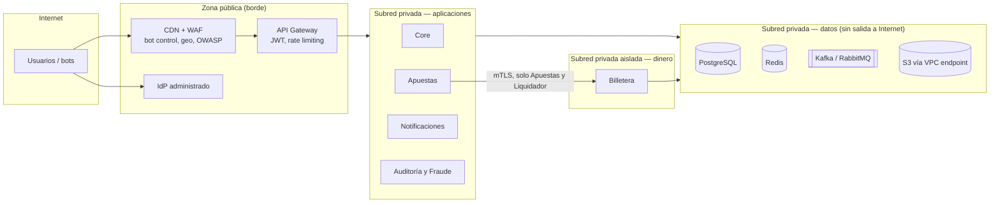

# 13. Estrategia de seguridad

## 13.1 Componentes públicos vs. privados

| Componente | Exposición | Motivo |
|---|---|---|
| CDN + WAF | **Pública** | Primera barrera: absorbe DDoS, bots y ataques web (OWASP Top 10). |
| API Gateway | **Pública** (solo detrás de la CDN) | Punto único de entrada a las APIs. |
| IdP | **Pública** (servicio administrado) | Login, MFA y emisión de tokens. |
| Core, Apuestas, Notificaciones, Auditoría y Fraude | **Privada** | Solo accesibles desde el Gateway o entre sí. |
| Billetera | **Privada y aislada** | Solo acepta conexiones (mTLS) de Apuestas‑API y del Liquidador, más las lecturas de saldo desde el Gateway. |
| Bases de datos, Redis, Kafka, RabbitMQ | **Privada sin salida a Internet** | Acceso solo por *security groups* desde los servicios dueños. |
| Panel de administración | **Privada** (vía VPN/ZTNA + IdP con MFA) | Las operaciones administrativas no se exponen al Internet abierto. |

## 13.2 Autenticación y autorización

| Tema | Decisión |
|---|---|
| **Autenticación** | IdP administrado (Amazon Cognito, Auth0 o Keycloak administrado) con OIDC, *Authorization Code* + PKCE. **Las contraseñas nunca tocan nuestros servicios** (el IdP las guarda con *hash* fuerte). |
| **Tokens** | JWT de acceso de **15 min** firmados (RS256), *refresh tokens* rotativos. Al bloquear un usuario se revocan sus sesiones y se agrega a la lista de bloqueados en Redis, para un efecto inmediato. |
| **MFA** | **Obligatorio** para `OPERADOR`, `ADMIN` y `AUDITOR`. Opcional para `APOSTADOR`. |
| **Roles (RBAC)** | `APOSTADOR` (apostar, ver lo propio), `OPERADOR` (gestionar carreras, registrar resultados), `ADMIN` (usuarios, roles, aprobar resultados y correcciones), `AUDITOR` (**solo lectura** del registro de auditoría). |
| **Autorización en dos niveles** | **Gateway**: el rol del token permite o no la ruta. **Servicio**: reglas de propiedad. El `usuario_id` **siempre sale del token (`sub`)**, nunca del cuerpo de la petición, así que un apostador no puede ver ni gastar el saldo de otro. |
| **Separación de funciones** | Publicar o corregir resultados exige **dos personas** (operador registra, admin aprueba). Nadie se aprueba a sí mismo. El auditor no puede modificar nada. |
| **Servicio a servicio** | **mTLS** con identidades por servicio (certificados de corta duración). La Billetera tiene una *allowlist* de identidades (Apuestas‑API, Liquidador) y de métodos gRPC por identidad: el Liquidador puede acreditar pero no debitar por apuestas. |

## 13.3 Protección de APIs

- **Validación estricta** de entradas (esquemas OpenAPI/Protobuf): montos positivos con límites, IDs con formato, rechazo de campos desconocidos.
- **Rate limiting** en el Gateway: por usuario (p. ej., 5 apuestas/s y 60/min), por IP y por huella de dispositivo. Límites más estrictos para login y registro.
- **Anti‑bots**: WAF con reglas de *bot control*, CAPTCHA en registro y tras logins fallidos, límite de cuentas por dispositivo. Las señales (dispositivo, IP) alimentan a Fraude.
- **CORS** restringido a los dominios de la app. Cabeceras de seguridad (HSTS, CSP).
- **Idempotency-Key obligatoria** en `POST /apuestas`: también evita que una repetición maliciosa (*replay*) duplique el efecto.

## 13.4 Cifrado y manejo de credenciales

| Tema | Decisión |
|---|---|
| **En tránsito** | TLS 1.2+ (preferente 1.3) desde el cliente hasta el Gateway. **mTLS** entre servicios internos. TLS hacia BD, Redis, Kafka y RabbitMQ. |
| **En reposo** | Cifrado con KMS en todas las BD, *snapshots*, S3, Kafka y Redis. |
| **Datos personales** | Cifrado a nivel de campo (documento, teléfono, fecha de nacimiento) en el esquema de Usuarios. Los eventos **no** transportan datos personales. |
| **Movimientos de billetera** | Acceso solo por la API de la Billetera. Ledger *append-only* (se revocan `UPDATE` y `DELETE`). |
| **Secretos** | **AWS Secrets Manager** con rotación automática. Nada en el código, en las imágenes ni en variables de repositorios. Los *pods* obtienen credenciales con roles de IAM (sin llaves estáticas). |
| **Mínimo privilegio** | Un usuario de BD por servicio o módulo, con acceso solo a su esquema. |

## 13.5 Registro de acciones administrativas

- Toda acción de `OPERADOR` o `ADMIN` (crear carrera, cambiar roles, bloquear, publicar o corregir resultados, ajustes de saldo) emite `AccionAdministrativa` con **quién, qué, cuándo, desde dónde, valor antes y después**.
- Se almacena en **S3 Object Lock (modo *compliance*)** durante 5 años: **ni un administrador de la nube puede borrarlo ni alterarlo**.
- Los registros de acceso del Gateway y de la nube (CloudTrail) también se envían al almacén inmutable.
- Fraude genera alertas ante patrones: muchas cuentas por dispositivo, ráfagas en los últimos segundos antes del cierre, montos atípicos, cambios de rol inusuales.
