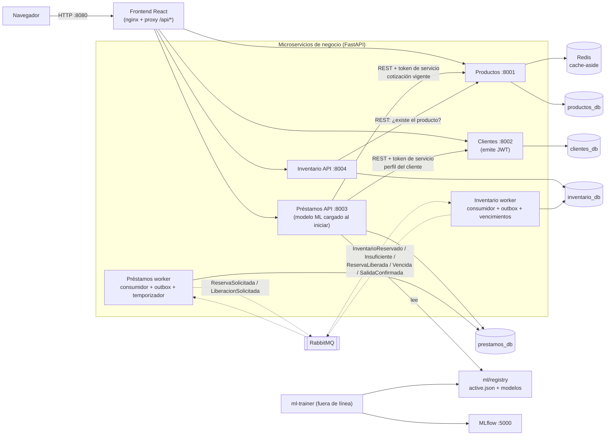
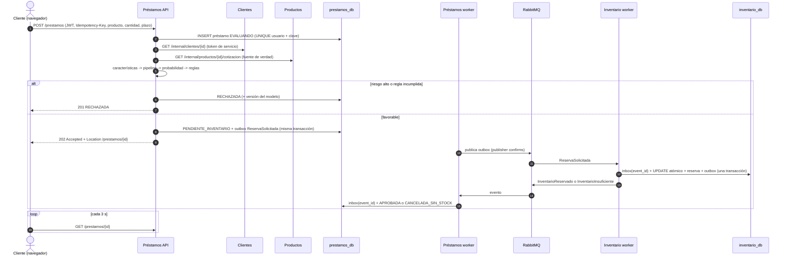

# Arquitectura de CrediMarket

## 1. Vista general

* Línea sólida: llamada síncrona HTTP. Línea punteada: mensaje asíncrono por RabbitMQ.
* **Una sola instancia de PostgreSQL** con **cuatro bases lógicas** y **cuatro usuarios** (`productos_user`, …).
  Cada usuario solo puede conectarse a su base (`REVOKE ALL … FROM PUBLIC`): está prohibido y es imposible consultar tablas de otro servicio.
* RabbitMQ, Redis, PostgreSQL y MLflow son infraestructura. El entrenamiento es un proceso fuera de línea (`ml-trainer`, perfil `ml`), no un quinto servicio.
* Cada servicio que usa mensajería tiene dos procesos con la **misma imagen y la misma base**: la API y un *worker*. Siguen siendo un solo microservicio.

## 2. Responsabilidades

| Servicio | Hace | No hace |
|---|---|---|
| **Productos** | CRUD de productos, precio, categoría y **versión** (cada cambio incrementa la versión e historial de precios). Caché Redis *cache-aside*. Cotización interna leída **siempre** de PostgreSQL. | No maneja existencias ni decide préstamos. |
| **Clientes** | Registro, consulta y actualización de clientes con información financiera y laboral. Importación CSV idempotente. Usuarios y emisión de JWT (RS256). | No ejecuta el modelo ni toca inventario. |
| **Préstamos** | `POST /prestamos` con `Idempotency-Key`. Reúne datos por API, ejecuta el pipeline, aplica reglas y gestiona la máquina de estados. Publica comandos (outbox) y consume eventos de Inventario. | No lee tablas de otros servicios. No confía en precios enviados por el cliente. |
| **Inventario** | Existencias, reserva **atómica** (`UPDATE … WHERE disponible >= cantidad` + `CHECK disponible >= 0`), liberación, confirmación de salida, vencimiento de reservas y movimientos. | No conoce información financiera del cliente. |

## 3. Secuencia del flujo de financiación

## 4. Seguridad

| Tema | Implementación |
|---|---|
| Autenticación | JWT **RS256** de 30 min emitido por Clientes. Solo Clientes tiene la clave privada; los demás servicios verifican con la pública. |
| Roles | `CLIENTE` y `ADMIN`, validados **en el backend** de cada servicio. El frontend solo oculta menús. |
| Propiedad | Un cliente solo ve y cancela **sus** préstamos (`usuario_id` del token, nunca del cuerpo) y solo ve y edita **su** ficha de cliente. |
| Llamadas internas | Endpoints `/internal/*` exigen un **token de servicio** HS256 de 60 s firmado con un secreto interno (o rol ADMIN). Un `cliente_id` recibido nunca basta. |
| Secretos | Los genera `secrets-init` en `./.secrets` (ignorado por Git) y se montan en `/run/secrets` (`*_FILE`). El repositorio y el compose no contienen secretos. |
| Contraseñas | `scrypt` con sal (librería estándar). |
| Entradas | Pydantic con `extra="forbid"`: p. ej. un `precio` enviado por el cliente → 422. |
| Frontend | Solo habla con las APIs (proxy nginx, mismo origen). CORS configurable con `CORS_ORIGINS`. Sin secretos en el código. |

## 5. Puertos

| Componente | URL |
|---|---|
| Frontend | http://localhost:8080 |
| Productos / Clientes / Préstamos / Inventario | http://localhost:8001 … 8004 (documentación OpenAPI en `/docs`) |
| MLflow | http://localhost:5000 |
| RabbitMQ (administración) | http://localhost:15672 |
