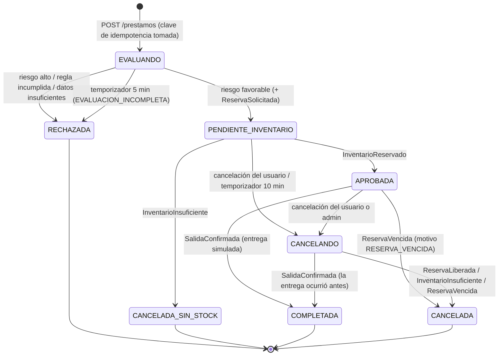

# Máquina de estados del préstamo

* Los estados **obligatorios** del enunciado están todos.
* **EVALUANDO** y **CANCELANDO** son estados internos:
  * `EVALUANDO` permite la idempotencia HTTP. La clave queda tomada antes de llamar a otros servicios, y un reintento con la misma clave **reanuda** la evaluación.
  * `CANCELANDO` cumple "una cancelación previa a la entrega debe **liberar la reserva antes** de finalizar como CANCELADA".
* Cada transición se valida en código (`services/prestamos/app/estados.py`) y queda registrada en `prestamo_historial` con estado anterior, nuevo, motivo, origen y fecha.

## Tiempos de espera

| Variable | Valor por defecto | Efecto |
|---|---|---|
| Timeout HTTP hacia Clientes y Productos | 3 s (conexión 1 s) | Responde `503` y la solicitud queda `EVALUANDO`. Reintentar con la **misma** `Idempotency-Key` reanuda. |
| `EVALUANDO_TIMEOUT_SEGUNDOS` | 300 | Si nadie reintenta, pasa a `RECHAZADA` (motivo `EVALUACION_INCOMPLETA`). |
| `PENDIENTE_TIMEOUT_SEGUNDOS` | 600 | Si Inventario no responde, pasa a `CANCELANDO` y se envía `LiberacionSolicitada` (motivo `TIEMPO_ESPERA_INVENTARIO`). |
| `CANCELANDO_REINTENTO_SEGUNDOS` | 120 | Reenvía `LiberacionSolicitada` (idempotente) mientras no llegue la confirmación. |
| `RESERVA_TTL_SEGUNDOS` (Inventario) | 1800 | Una reserva `ACTIVA` sin entrega vence: se liberan las unidades y se publica `ReservaVencida`. |
| Reintentos de mensajes | 3 × 5 s | Después, *dead letter*. |

El temporizador de Préstamos corre cada 15 s y el de vencimientos de Inventario cada 10 s. Todos los valores se configuran en `docker-compose.yml` o en el entorno.

## Eventos tardíos y casos límite

| Caso | Comportamiento |
|---|---|
| `InventarioReservado` llega con el préstamo en `CANCELANDO` | Se ignora: la `LiberacionSolicitada` ya está en camino y liberará esa reserva. |
| `InventarioReservado` llega con el préstamo `CANCELADA`, `RECHAZADA` o `CANCELADA_SIN_STOCK` | **Nunca reactiva** el préstamo. Préstamos envía una `LiberacionSolicitada` de seguridad (idempotente). |
| La cancelación llega a Inventario **antes** que la reserva | Inventario crea una reserva "lápida" `LIBERADA` con 0 unidades y responde `ReservaLiberada`. Cuando llega la `ReservaSolicitada`, `UNIQUE(prestamo_id)` la encuentra y **no reserva**. |
| La reserva vence con el préstamo `APROBADA` | `ReservaVencida` → `CANCELADA` con motivo `RESERVA_VENCIDA`. Un préstamo aprobado no conserva una reserva inexistente. |
| Se confirma la entrega de una reserva vencida | Inventario la rechaza con `409`. |
| Se pide cancelar después de la entrega | Inventario responde `SalidaConfirmada` y Préstamos registra `COMPLETADA`: la entrega física prevalece. |
| Eventos duplicados | Inbox por `event_id` (ver [decision-broker.md](decision-broker.md)). |

Estas reglas se demuestran en las pruebas de aceptación 5 y 7 (`scripts/pruebas_aceptacion.py`).
