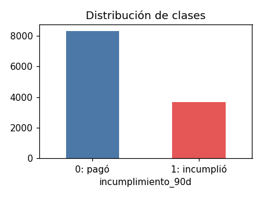
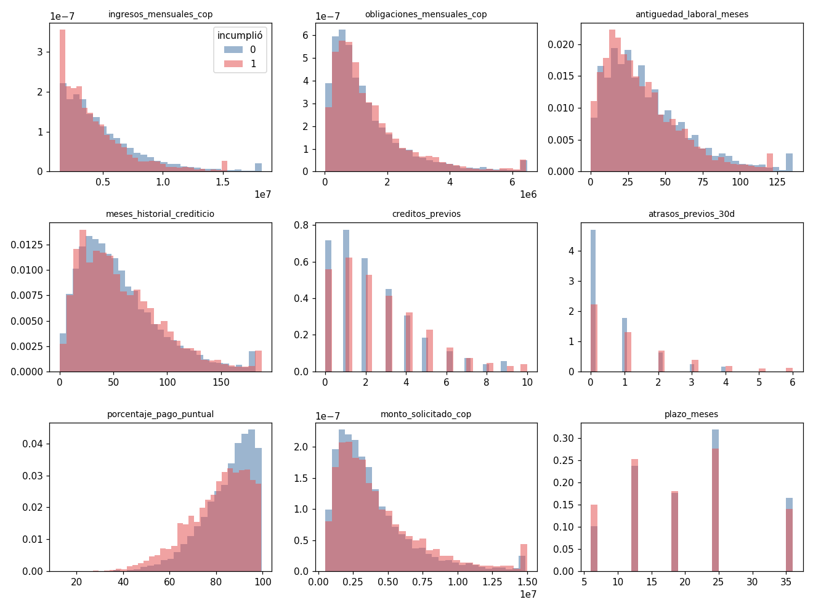
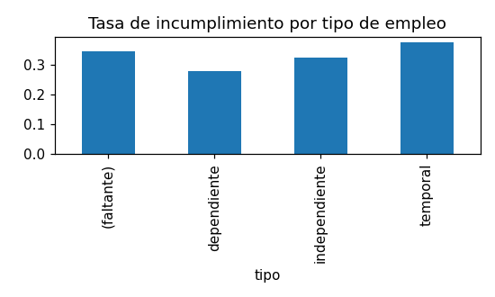

# Análisis exploratorio y validación de datos

* **Archivo:** `prestamos_entrenamiento.csv` — **SHA-256:** `c6cdc437c3aecc9116bc8b978df421d5a7600634c1ad7d6f82e58222a2446ecd`
* **Filas:** 12,000 — **Columnas:** 15
* **Tasa de incumplimiento (clase 1):** 30.56% (desbalance moderado: no se selecciona por accuracy)
* **Duplicados:** {'solicitud_id': 0, 'cliente_id': 0, 'filas_sin_ids': 0}
* **Valores fuera de rango:** ninguno
* **Columnas constantes:** ['tasa_mensual_simulada'] → se excluyen.
* **Cuota redundante:** diferencia máxima con la fórmula = 0.005 COP → se excluye como entrada y se recalcula en el pipeline.

## Faltantes

| Columna | Faltantes | % | Tratamiento |
|---|---|---|---|
| tipo_empleo | 93 | 0.78 | categoría 'desconocido' |
| antiguedad_laboral_meses | 91 | 0.76 | mediana + indicador |
| meses_historial_crediticio | 97 | 0.81 | mediana + indicador |
| porcentaje_pago_puntual | 2473 | 20.61 | mediana + indicador (faltante = sin historial previo, es informativo) |

## Particiones

| Partición | Filas | Tasa de incumplimiento |
|---|---|---|
| train | 7200 | 30.57% |
| val | 2400 | 30.54% |
| test | 2400 | 30.54% |

## Estadísticas descriptivas

|                            |   count |         mean |          std |          min |              25% |            50% |          75% |          max |
|:---------------------------|--------:|-------------:|-------------:|-------------:|-----------------:|---------------:|-------------:|-------------:|
| ingresos_mensuales_cop     |   12000 |  4.82894e+06 |  3.38513e+06 |      1.4e+06 |      2.52275e+06 |      3.905e+06 |  6.09e+06    |   2.8e+07    |
| obligaciones_mensuales_cop |   12000 |  1.36815e+06 |  1.31341e+06 |  11000       | 524750           | 972000         |  1.76425e+06 |   1.6485e+07 |
| antiguedad_laboral_meses   |   11909 | 37.38        | 28.33        |      0       |     17           |     31         | 51           | 240          |
| meses_historial_crediticio |   11903 | 56.38        | 38.82        |      0       |     28           |     48         | 76           | 300          |
| creditos_previos           |   12000 |  2.37        |  2.23        |      0       |      1           |      2         |  4           |  19          |
| atrasos_previos_30d        |   12000 |  0.78        |  1.22        |      0       |      0           |      0         |  1           |  12          |
| porcentaje_pago_puntual    |    9527 | 83.47        | 12.02        |     12.68    |     76.62        |     86.09      | 92.91        |  99.97       |
| monto_solicitado_cop       |   12000 |  4.02514e+06 |  2.91249e+06 | 500000       |      1.98575e+06 |      3.2e+06   |  5.136e+06   |   1.5e+07    |
| plazo_meses                |   12000 | 19.82        |  9.18        |      6       |     12           |     18         | 24           |  36          |

## Figuras

