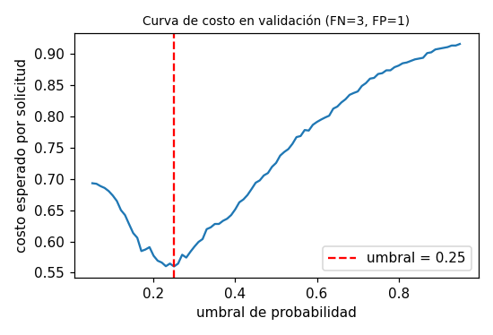
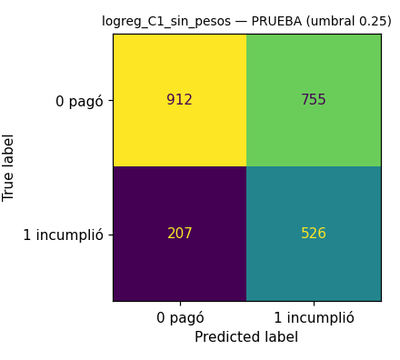
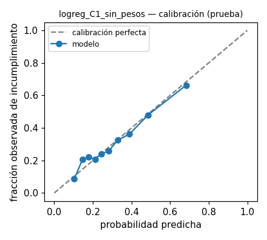

# Informe de selección — modelo v1

* **Ejecución seleccionada:** `logreg_C1_sin_pesos` (run `c25303263a3242138d42879ea80603e6`)
* **Métrica de selección (definida antes de comparar):** `val_average_precision` (average precision de la clase 1 en validación: resume precisión/recall sin depender del umbral y es sensible al desbalance).
* **Desempate:** si |ΔAP| < 0.005 se consideran empatados; entre ellos, los que estén a < 0.005 del mayor val_roc_auc; si persiste: menor complejidad (logreg < arbol < hgb < rf); si persiste: menor val_brier (mejor calibración).
* **Umbral:** 0.25, elegido en validación minimizando el costo esperado con costos ficticios FN=3 (aprobar a quien incumplirá) y FP=1 (rechazar a quien habría pagado). Se congeló antes de evaluar en prueba.

## Ranking en validación (umbral de referencia 0,5 para precision/recall/F1)

| Ejecución | Familia | AP | ROC-AUC | F1 clase 1 | Brier |
|---|---|---|---|---|---|
| logreg_C1_sin_pesos | logreg | 0.5208 | 0.6961 | 0.3692 | 0.1887 |
| logreg_C1_balanced | logreg | 0.5208 | 0.6961 | 0.5106 | 0.2175 |
| logreg_C0.05_balanced | logreg | 0.5204 | 0.6958 | 0.5097 | 0.2175 |
| hgb_lr0.05_hojas15 | hgb | 0.5049 | 0.6882 | 0.3724 | 0.1920 |
| hgb_lr0.1_prof4 | hgb | 0.5010 | 0.6824 | 0.3695 | 0.1932 |
| rf_200_d8 | rf | 0.4942 | 0.6834 | 0.4912 | 0.2138 |
| rf_200_d12 | rf | 0.4895 | 0.6821 | 0.4625 | 0.2045 |
| arbol_d4_hoja50 | arbol | 0.4621 | 0.6679 | 0.4948 | 0.2229 |
| arbol_d8_hoja20 | arbol | 0.4418 | 0.6327 | 0.4673 | 0.2420 |

## Métricas finales en PRUEBA (una sola evaluación, umbral congelado)

| Métrica | Valor |
|---|---|
| test_precision_1 | 0.4106 |
| test_recall_1 | 0.7176 |
| test_f1_1 | 0.5223 |
| test_roc_auc | 0.6967 |
| test_average_precision | 0.5331 |
| test_brier | 0.1870 |
| test_accuracy | 0.5992 |
| test_tn | 912 |
| test_fp | 755 |
| test_fn | 207 |
| test_tp | 526 |
| test_costo_esperado | 0.5733 |

## Figuras

  

> La probabilidad es una salida del modelo sobre datos sintéticos; no representa el riesgo real de personas.
