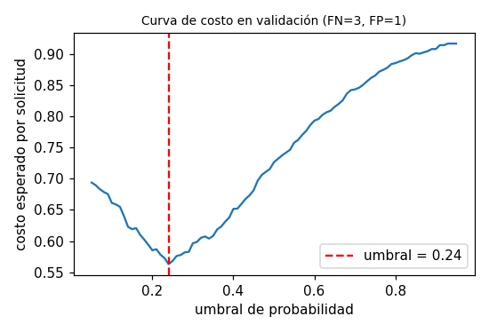
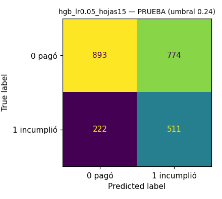
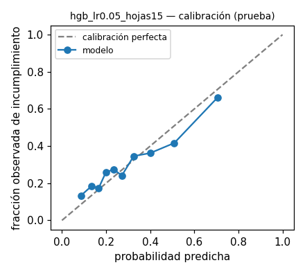

# Informe de selección — modelo v2

* **Ejecución seleccionada:** `hgb_lr0.05_hojas15` (run `3f88a85614734dad8fdf6deea50755bd`) — restringido a la familia `hgb`
* **Métrica de selección (definida antes de comparar):** `val_average_precision` (average precision de la clase 1 en validación: resume precisión/recall sin depender del umbral y es sensible al desbalance).
* **Desempate:** si |ΔAP| < 0.005 se consideran empatados; entre ellos, los que estén a < 0.005 del mayor val_roc_auc; si persiste: menor complejidad (logreg < arbol < hgb < rf); si persiste: menor val_brier (mejor calibración).
* **Umbral:** 0.24, elegido en validación minimizando el costo esperado con costos ficticios FN=3 (aprobar a quien incumplirá) y FP=1 (rechazar a quien habría pagado). Se congeló antes de evaluar en prueba.

## Ranking en validación (umbral de referencia 0,5 para precision/recall/F1)

| Ejecución | Familia | AP | ROC-AUC | F1 clase 1 | Brier |
|---|---|---|---|---|---|
| hgb_lr0.05_hojas15 | hgb | 0.5049 | 0.6882 | 0.3724 | 0.1920 |
| hgb_lr0.1_prof4 | hgb | 0.5010 | 0.6824 | 0.3695 | 0.1932 |

## Métricas finales en PRUEBA (una sola evaluación, umbral congelado)

| Métrica | Valor |
|---|---|
| test_precision_1 | 0.3977 |
| test_recall_1 | 0.6971 |
| test_f1_1 | 0.5064 |
| test_roc_auc | 0.6807 |
| test_average_precision | 0.5112 |
| test_brier | 0.1927 |
| test_accuracy | 0.5850 |
| test_tn | 893 |
| test_fp | 774 |
| test_fn | 222 |
| test_tp | 511 |
| test_costo_esperado | 0.6000 |

## Figuras

  

> La probabilidad es una salida del modelo sobre datos sintéticos; no representa el riesgo real de personas.
